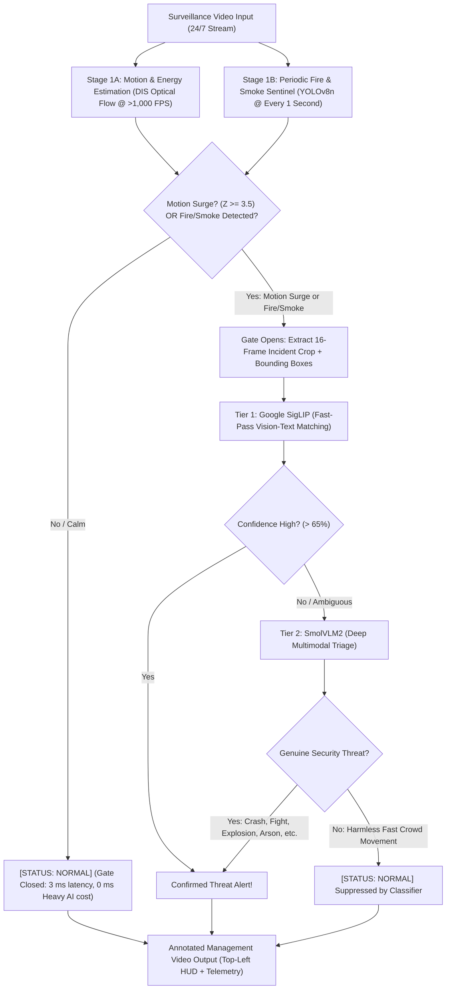

# Intelligent Video Surveillance Anomaly Detection: Executive & Management Guide

This document provides a non-technical, high-level explanation of the crowd and video surveillance anomaly detection system. It explains the technology, the operational workflow, the cost and performance rationale, the visual indicators on the video output, and a file-by-file directory map of the codebase.

---

## 1. Executive Summary & Problem Solved

Modern physical security relies on thousands of closed-circuit television (CCTV) cameras streaming video 24 hours a day, 7 days a week. Human operators cannot monitor dozens of screens simultaneously without experiencing severe fatigue and missing critical incidents. 

Traditional AI solutions that run large Visual Language Models (VLMs) continuously on every camera frame are **cost-prohibitive** and **too slow**:
- A single camera generates ~2.5 million frames per day.
- Running heavy multimodal AI on every frame would require massive cloud GPU clusters costing tens of thousands of dollars per month.

### The Solution: A Two-Stage Gated Architecture
Our architecture functions like an efficient security team:
1. **The Fast Front-Line Sentinel (Stage 1 Motion Gate)**: An ultra-lightweight mathematical tripwire that screens camera feeds at over **1,000 frames per second** (< 3 milliseconds per frame). Over 95% of normal, peaceful surveillance footage is cleared immediately with **zero GPU AI cost**.
2. **The Specialized Expert Arbitrator (Stage 2 Multimodal AI Cascade)**: When the front-line sentinel detects an abnormal surge of motion or chaos, it "swings open the gate," extracts a **16-frame event crop** of the action, and summons specialized AI models to determine whether it is a genuine security threat and identify the exact incident type.

---

## 2. End-to-End Operational Workflow

The diagram below illustrates how video streams flow through the pipeline from raw camera intake to the management video HUD:



---

## 3. Core Concepts Explained in Layman Terms

### A. Optical Flow & Motion Energy (Stage 1A)
Optical flow is a computer vision technique that tracks how pixels move between adjacent video frames. Instead of "understanding" what objects are, it simply measures:
- **Speed**: How fast things are moving.
- **Direction & Chaos**: Are people moving smoothly in one direction (like commuters on a crosswalk), or is motion suddenly erratic and colliding in all directions (like a fistfight or crowd stampede)?

### B. Periodic Fire & Smoke Sentinel (Stage 1B - YOLOv8)
Fire and arson often begin as slow-burning flames or rising smoke with minimal rapid motion. To prevent silent ignition from being missed by motion screening alone, the system runs a specialized **YOLOv8 Fire/Smoke detector periodically** (e.g., every 1 second / 5 frames, taking only ~11 ms). 
- If persistent smoke or active flame is detected, it draws dedicated bounding boxes labeled `Fire` or `Smoke` and directly flags the gate as an active hazard.

### C. The "Gate"
The "Gate" is the decision tripwire. The system observes the camera view to determine its normal baseline activity. When the motion energy in any part of the scene exceeds **3.5 standard deviations** above normal ($Z \ge 3.5$) **OR** the periodic YOLO sentinel spots fire/smoke, the gate trips and escalates the incident to Stage 2.

### C. The 16-Frame Event Crop
When the gate trips, the system does not re-process the entire video. It isolates a compact **16-frame window** centered on the exact peak of the commotion. This focused clip contains the critical onset of the event and is fed to the multimodal classifiers.

### D. What Does "Classifier Suppressed" Mean?
Not all sudden movements are dangerous:
- A commuter running to catch a departing bus.
- A delivery driver stepping quickly out of a van.
- A sudden gust of wind moving background foliage.

When these happen, Stage 1 detects high energy and triggers the gate. However, when the visual AI (SigLIP / SmolVLM2) inspects the cropped frames, it understands the context: *"This is just a person running to catch a train, not a violent brawl."*
The AI **suppresses** the alarm back to **Normal**:
`[STATUS: NORMAL] Suppressed by Classifier (Normal Crowd)`
This eliminates false alarms while ensuring unusual motion is always audited.

---

## 4. Visual HUD Color Conventions

Every generated video features a standardized visual display designed for security operations centers and management reviews:

| Visual Element | Color | Exact Meaning |
|---|---|---|
| **Top-Left Status Banner** | **Green** | `[STATUS: NORMAL]` — Gate is quiet. Scene motion and crowd activity match normal baseline. |
| **Top-Left Status Banner** | **Amber / Orange** | `[STATUS: ABNORMAL (S1)]` — Motion tripwire triggered ($Z \ge 3.5$). The system is actively examining the event. |
| **Top-Left Status Banner** | **Crimson Red** | `[STATUS: ABNORMAL]` — **Confirmed Threat!** Multimodal AI identified the specific threat category (`Car Accident`, `Fighting`, `Explosion`, `Shooting`, `Arson`, `Violence`). |
| **Top-Left Status Banner** | **Cyan / Dark Gray** | `[STATUS: NORMAL]` — **Suppressed by Classifier**. High motion occurred, but AI confirmed it was harmless everyday activity. |
| **Top-Right Telemetry Box** | **Charcoal & Neon** | Operational Edge Telemetry: Video timestamp, Stage 1 latency (ms), Stage 2 latency (ms), and processing throughput (FPS). |
| **Spatial Bounding Box** | **Orange / Blue** | Visual region flagged by the motion grid during screening. |
| **Spatial Bounding Box** | **Red** | Confirmed location of the active incident. |

---

## 5. Target Classification Taxonomy (7 Classes)

The system is configured to detect and categorize seven specific surveillance states:
1. **Normal**: Peaceful everyday pedestrian, vehicular, or building activity.
2. **Violence**: Riot, mob assault, property vandalism, civil disorder.
3. **Fighting**: Physical fistfight, hand-to-hand brawling, punching, kicking.
4. **Arson**: Intentional fire ignition, burning structures or objects, active flames, smoke plumes.
5. **Car Accident**: Vehicular collision, traffic crash, vehicle impacts.
6. **Explosion**: Detonation blast shockwave, fireball, structural explosion, flying debris.
7. **Shooting**: Gunfire, active shooter, armed weapon brandishing or discharge.

---

## 6. Project Architecture & File Roadmap

To help the team understand which file is doing what and where to make modifications:

```
crowd_anomaly_one_shot/
│
├── README_MANAGEMENT.md          # THIS FILE: Non-technical executive overview
├── run_single_video.py           # CLI tool to run end-to-end inference on ANY single video
│
├── src/                          # Core Algorithm Modules
│   ├── video_io.py               # Fast sequential video reading & resizing
│   ├── motion.py                 # DIS optical flow motion computation (>1000 FPS)
│   ├── baseline.py               # Dynamic statistical scene baseline (median, MAD)
│   ├── gate.py                   # Stage 1 motion tripwire logic and thresholding
│   ├── roi.py                    # Spatial bounding box extraction for commotion areas
│   ├── viz.py                    # Legacy visual rendering tools
│   └── zeroshot.py               # Fast zero-shot classifier interface
│
├── eval/                         # Standalone Evaluation & Production Suite
│   ├── config_eval.py            # Master settings: 7 classes, thresholds, models, FPS
│   ├── prompts_eval.py           # Caption banks for SigLIP and diagnostic prompts for SmolVLM2
│   ├── models_eval.py            # AI model loaders and SigLIP + SmolVLM2 cascade inference
│   ├── viz_eval.py               # Management top-left 3-state HUD and top-right telemetry renderer
│   ├── data/
│   │   ├── manifest.csv          # Catalog of 200 authentic Kaggle clips (XD-Violence & UCF-Crime)
│   │   ├── ucf_crime/            # Verified UCF-Crime surveillance clips
│   │   └── xd_violence/          # Verified XD-Violence surveillance clips
│   ├── outputs/
│   │   ├── eval_results.csv      # Complete CSV log with ground truth, predictions, and latencies
│   │   ├── metrics_summary.md    # Markdown table of precision, recall, F1-scores, and throughput
│   │   ├── confusion_matrix.png  # Confusion matrix chart across all 7 classes
│   │   └── videos/               # Rendered annotated MP4 videos with full HUD overlays
│   └── scripts/
│       ├── download_and_sample.py# Automatic streaming ingest of benchmark datasets
│       └── run_evaluation.py     # Batch evaluation runner with progress bar & CSV logging
```

---

## 7. Advanced Configuration & Model Switching

The pipeline supports seamless configuration for different compute tiers and accuracy requirements via [`src/config.py`](file:///c:/Projects/ai-dreams/crowd_anomaly_one_shot/src/config.py) and CLI flags:

### A. Switchable Vision Backbones (Tier 1 SigLIP)
Choose the optimal balance of speed and spatial resolution:
- **`so400m`** (`google/siglip-so400m-patch14-384`, **Default**): 400M parameter vision backbone operating at **$384 \times 384$** resolution. Delivers state-of-the-art fine-grained feature detection on small weapons, distant smoke, and subtle physical struggles.
- **`base`** (`google/siglip-base-patch16-224`): 86M parameter vision backbone operating at **$224 \times 224$** resolution for ultra-low latency edge devices.
- **`large`** (`google/siglip-large-patch16-384`): 300M parameter vision backbone.

### B. Flexible Multi-Frame SmolVLM2 Ingestion (Tier 2)
Choose how temporal context is delivered to SmolVLM2:
- **`16` (Default)**: Combines all 16 frames into a **$4 \times 4$ temporal storyboard contact sheet**. Gives the VLM complete visibility into the temporal progression of the event (punches landing, car impact, flame growth) while fitting safely within the model's 16k context window (~1,136 visual tokens).
- **`4`**: Uniformly samples 4 discrete image frames across the event window.
- **`1`**: Single static snapshot (the center frame of peak commotion).

### C. Hard-Negative Prompt Engineering
The SigLIP prompt bank includes dedicated **Hard-Negative prompts** for the `Normal` class:
- Commuters running to catch a bus or train.
- Pedestrians walking quickly while carrying backpacks, large bags, or pushing carts.
- Natural hand gesturing, talking, and non-violent interactions.
- Routine street traffic with moving cars, buses, and cyclists.
This prevents benign fast crowd motion from triggering false alerts for `Violence` or `Fighting`.

### D. Dynamic Hardware Auto-Detection
The top-right **Edge Telemetry HUD** dynamically queries the underlying host system at runtime:
- **NVIDIA GPU**: Automatically displays `EDGE TELEMETRY (RTX 4060)`, `EDGE TELEMETRY (A100)`, etc.
- **Apple Silicon**: Displays `EDGE TELEMETRY (Apple MPS)`.
- **CPU Servers**: Displays `EDGE TELEMETRY (CPU)`.

---

## 8. How to Run Single-Video Inference

To run the complete pipeline on any video and generate the annotated management video:

```powershell
# 1. Activate python environment
conda activate pyt-dl

# 2. Run inference on any single video file (uses so400m backbone & 16-frame VLM by default)
python run_single_video.py --video "path/to/surveillance_clip.mp4" --output "output_annotated.mp4"

# 3. Optional: Switch backbone or frame count
python run_single_video.py --video "path/to/clip.mp4" --backbone base --num_frames_vlm 1
```

The script will automatically:
1. Scan the video using fast optical flow + periodic YOLO fire/smoke screening.
2. Locate the peak motion activity or active flame/smoke.
3. Classify the event using SigLIP SO400M (Tier 1) and SmolVLM2 (Tier 2).
4. Save the annotated video with the top-left management HUD and dynamic hardware telemetry.
5. Print execution latencies and classification confidence.

