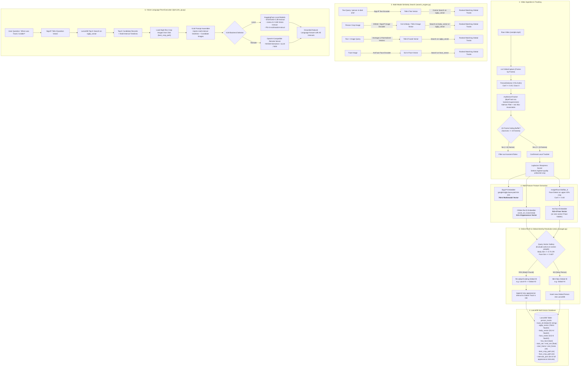

# Auditorium Tracker & Video Semantic Search (VSS) Pipeline

A modular, 100% local computer vision and video intelligence pipeline designed for single-camera auditorium surveillance, temporal tracking, **online global re-identification (Re-ID)**, multi-feature vector search, and Vision-Language Model (VLM) post-execution Q&A.

---

## 1. End-to-End Architecture Flowchart



---

## 2. Repository File Breakdown

| File | Purpose & Responsibilities | Key Dependencies |
| :--- | :--- | :--- |
| [`detector.py`](file:///c:/Projects/ai-dreams/multi-feature-track-vss/detector.py) | **YOLOv8 Person Detection Module.** Wraps `ultralytics.YOLO("yolov8n.pt")`. Filters specifically for class `0` (`person`) with confidence $\ge 0.40$. Returns bounding boxes `[x1, y1, x2, y2]` and confidence scores. | `ultralytics`, `torch`, `numpy` |
| [`tracker.py`](file:///c:/Projects/ai-dreams/multi-feature-track-vss/tracker.py) | **Kalman Filter Tracking & Gating Buffer.** Integrates modern Roboflow `trackers.ByteTrackTracker` (with automatic fallback to `supervision.ByteTrack`). Maintains a 24-frame history buffer for each tracklet to reject transient noise. Computes Laplacian variance for every crop to dynamically select and store the sharpest, unblurred image of the person. | `trackers`, `supervision`, `opencv-python` |
| [`reid_manager.py`](file:///c:/Projects/ai-dreams/multi-feature-track-vss/reid_manager.py) | **Online Global Re-ID Gallery Manager.** Resolves local ByteTrack tracklets to canonical Global Person IDs before database insertion. Implements spatiotemporal mutual exclusion (cannot match people active on-screen simultaneously) and dual-tier matching (ArcFace face similarity $\ge 0.60$ and OSNet body appearance similarity $\ge 0.75$). Manages multi-interval timelines (`intervals_json`). | `numpy`, `json`, `vector_store` |
| [`embedder.py`](file:///c:/Projects/ai-dreams/multi-feature-track-vss/embedder.py) | **Feature Extraction Engine.** Extracts two complementary visual representations: <br/>1. **768-d SigLIP vector** (`google/siglip-base-patch16-224`) for zero-shot semantic text-to-image matching.<br/>2. **512-d OSNet vector** (`torchreid.models.osnet_x0_5`) for fine-grained person Re-Identification across camera views. | `transformers`, `torchreid`, `torch`, `PIL` |
| [`face_module.py`](file:///c:/Projects/ai-dreams/multi-feature-track-vss/face_module.py) | **Facial Feature Extractor.** Runs InsightFace (`buffalo_s`) specifically on the upper 40% of the body bounding box crop. If a valid face is detected with detection score $\ge 0.60$, it extracts a **512-d ArcFace vector** and saves the face crop. Otherwise, returns a clean 512-d zero vector. | `insightface`, `onnxruntime`, `opencv-python` |
| [`vector_store.py`](file:///c:/Projects/ai-dreams/multi-feature-track-vss/vector_store.py) | **LanceDB Vector Storage.** Creates and manages the embedded vector database (`data/lancedb/person_tracks.lance`). Enforces structured PyArrow schema storing multiple vector columns (`siglip_vector`, `body_vector`, `face_vector`) alongside temporal metadata (`start_sec`, `end_sec`, `start_frame`, `end_frame`, `intervals_json`, crop paths). Supports schema evolution and reappearance updates. | `lancedb`, `pyarrow` |
| [`pipeline.py`](file:///c:/Projects/ai-dreams/multi-feature-track-vss/pipeline.py) | **Master Ingestion Orchestrator.** Connects video reading $\to$ detection $\to$ tracking $\to$ feature extraction $\to$ online global Re-ID $\to$ database insertion. Updates tracklet lifespans (`end_sec`, `end_frame`, `intervals_json`) upon video completion. | `opencv-python`, all local modules |
| [`search_engine.py`](file:///c:/Projects/ai-dreams/multi-feature-track-vss/search_engine.py) | **Multi-Modal Search CLI.** Executes vector similarity searches against LanceDB for: <br/>- `--text`: Natural language text query (SigLIP)<br/>- `--image`: Query by reference person image (OSNet appearance or SigLIP visual semantic)<br/>- `--face`: Query by reference facial photo (ArcFace)<br/>- `--video`: Query by reference video clip (averaged keyframe embeddings)<br/>- Combined `--text` + `--image` or `--text` + `--video` fused searches. Displays all disjoint appearance intervals. | `opencv-python`, `numpy`, `lancedb` |
| [`vlm_qa.py`](file:///c:/Projects/ai-dreams/multi-feature-track-vss/vlm_qa.py) | **VLM RAG Q&A Engine.** Decoupled architecture using `BaseVLMBackend` supporting: <br/>1. **Local Hugging Face backend:** SmolVLM2 (`HuggingFaceTB/SmolVLM2-2.2B-Instruct`), Llama 3.2 Vision (`meta-llama/Llama-3.2-11B-Vision-Instruct`), Phi-4 Multimodal (`microsoft/Phi-4-multimodal-instruct`).<br/>2. **Remote server backend:** OpenAI-compatible REST API for enterprise internal models (e.g. NVIDIA Nemotron, vLLM, NIM, Ollama). | `transformers`, `torch`, `PIL`, `urllib` |
| [`download_sample.py`](file:///c:/Projects/ai-dreams/multi-feature-track-vss/download_sample.py) | **Data Ingestion Utility.** Automatically downloads a test surveillance video to `data/raw_videos/sample.mp4` with SSL certificate verification fallbacks. | `urllib`, `ssl` |

---

## 3. In-Depth Operational Concepts

### A. How Data is Stored in LanceDB
Each confirmed global person is stored not as an arbitrary dictionary, but as a strongly-typed relational and vector record with three separate vector columns and a serialized multi-interval timeline:
```python
{
    "track_id": "2",                     # Canonical Global Person ID
    "siglip_vector": [0.021, -0.045, ...], # 768-d float32 vector (Text/Image semantic space)
    "body_vector":   [0.104, 0.003, ...],  # 512-d float32 vector (OSNet body appearance)
    "face_vector":   [-0.012, 0.820, ...], # 512-d float32 vector (ArcFace face identity)
    "has_face": True,                    # True if face was detected with conf >= 0.60
    "start_sec": 15.2,                   # First timestamp of appearance
    "end_sec": 33.3,                     # Last timestamp of appearance
    "start_frame": 183,                  # Starting frame index
    "end_frame": 400,                    # Ending frame index
    "best_crop_path": "data/crops/crop_local_2.jpg", # Path to sharpest unblurred body crop
    "face_crop_path": "data/crops/face_local_2.jpg", # Path to cropped face
    "video_source": "data/raw_videos/sample.mp4",
    "intervals_json": '[{"start_sec": 15.2, "end_sec": 20.0, "start_frame": 183, "end_frame": 240}, {"start_sec": 28.5, "end_sec": 33.3, "start_frame": 342, "end_frame": 400}]'
}
```

---

### B. Online Re-ID: How New Track IDs are Handled
When ByteTrack proposes a newly stabilized track (surviving the 24-frame gating buffer):
1. **Embedding Extraction:**
   - The sharpest crop is extracted via Laplacian variance.
   - The 512-d OSNet body appearance embedding ($\vec{v}_{\text{body}}$) and 512-d ArcFace facial embedding ($\vec{v}_{\text{face}}$) are computed.
2. **Spatiotemporal Mutual Exclusion Check:**
   - The system checks all active bounding boxes on screen in the current frame. Anyone currently visible is excluded as a match candidate (one human cannot be in two distinct locations simultaneously).
3. **Similarity Comparison Against Gallery:**
   - **Tier 1 (Face):** If both tracks have faces, $\cos(\vec{v}_{\text{face\_cand}}, \vec{v}_{\text{face}}) \ge 0.60 \implies$ Match!
   - **Tier 2 (Body Appearance):** $\cos(\vec{v}_{\text{body\_cand}}, \vec{v}_{\text{body}}) \ge 0.75 \implies$ Match!
4. **Resolution:**
   - **Match Found:** The local tracklet is mapped to the existing Global Person ID (`Local #3 -> Global #2`). A new interval is appended to that person's history, and the body embedding is smoothed ($70\%$ prior, $30\%$ new).
   - **No Match Found:** A new Global Person ID is minted and registered in the database.

---

### C. Which Vectors are Used During Similarity Search?

The vector space used depends directly on the query modality:

| Query Type | CLI Arguments | Query Vector Extraction | Vector Column Searched | Distance Metric |
| :--- | :--- | :--- | :--- | :--- |
| **Natural Language Text** | `--text "person in dark shirt"` | SigLIP Text Encoder $\to$ 768-d | `siglip_vector` | Cosine / L2 |
| **Reference Person Image (Appearance)** | `--image crop.jpg --mode reid` | OSNet Re-ID Model $\to$ 512-d | `body_vector` | Cosine / L2 |
| **Reference Person Image (Semantic)** | `--image crop.jpg --mode multimodal` | SigLIP Image Encoder $\to$ 768-d | `siglip_vector` | Cosine / L2 |
| **Face Image** | `--face face.jpg` | InsightFace ArcFace $\to$ 512-d | `face_vector` | Cosine / L2 |
| **Combined Text + Image** | `--text "..." --image "..."` | $\text{L2Norm}(\vec{v}_{\text{text}} + \vec{v}_{\text{img}})$ $\to$ 768-d | `siglip_vector` | Cosine / L2 |
| **Video Clip Query** | `--video clip.mp4` | Averaged SigLIP Keyframe Embeddings $\to$ 768-d | `siglip_vector` | Cosine / L2 |

---

### D. How Does VLM Q&A Work? (Two-Stage RAG)

VLMs cannot interpret raw float arrays like `[0.021, -0.045, ...]`. Instead, the pipeline performs **Two-Stage Retrieval-Augmented Generation (RAG)**:

1. **Stage 1 (Vector Candidate Filtering):**
   - The user asks: *"When was Track 2 visible?"*
   - SigLIP extracts the 768-d question embedding.
   - LanceDB queries the `siglip_vector` column to retrieve the **Top-$K$ candidate tracks**.
2. **Stage 2 (Visual Grounding & Multi-Interval Reasoning):**
   - The system retrieves the candidate metadata (Global Track IDs, full multi-interval appearance timelines) and loads the actual **high-resolution crop images** (`best_crop_path`) from `data/crops/`.
   - The prompt provides both the multi-interval timeline table and the candidate images to the VLM:
     ```
     Candidate #1 -> Global Track ID: #2, Timeline: 15.2s to 33.3s (Intervals: 15.2s-20.0s, 28.5s-33.3s)
     Candidate #2 -> Global Track ID: #4, Timeline: 29.0s to 33.4s
     
     User Question: When was Track 2 visible?
     ```
   - The VLM inspects the visual images and the timeline table, answering with precise visual grounding and timestamps across all appearances.

---

## 4. Quickstart Guide

### 1. Ingest Video & Build Vector Index (with Online Re-ID)
Run the end-to-end tracking, online re-identification, crop extraction, and vector indexing pipeline:
```powershell
# Default run with online Re-ID (body threshold = 0.75, face threshold = 0.60)
python pipeline.py --video data/raw_videos/sample.mp4

# Run with custom Re-ID threshold and visual display window
python pipeline.py --video data/raw_videos/sample.mp4 --reid-threshold 0.70 --display
```

### 2. Multi-Modal Semantic Search
Search using text, body image, face, or combined modalities:
```powershell
# Text-only search
python search_engine.py --text "person in dark shirt"

# Appearance Re-ID search using a reference crop
python search_engine.py --image data/crops/crop_local_2.jpg --mode reid

# Combined Text + Image search
python search_engine.py --text "walking slowly" --image data/crops/crop_local_2.jpg

# Face recognition search
python search_engine.py --face data/crops/face_local_2.jpg
```

### 3. Vision-Language Q&A
Ask natural language questions answered by local or remote VLMs:
```powershell
# Local SmolVLM2 (Default, lightweight and fast)
python vlm_qa.py --model-id HuggingFaceTB/SmolVLM2-2.2B-Instruct --question "When was Track 2 visible?"

# Local Llama-3.2-11B-Vision (Requires HF_TOKEN with Meta agreement accepted)
python vlm_qa.py --model-id meta-llama/Llama-3.2-11B-Vision-Instruct --question "Describe the person in Track 2."

# Local Phi-4 Multimodal
python vlm_qa.py --model-id microsoft/Phi-4-multimodal-instruct --question "Who is Track 2?"

# Remote Enterprise Server (NVIDIA Nemotron / vLLM / NIM / Ollama)
python vlm_qa.py --endpoint-url http://your-server:8000/v1/chat/completions --model-name nvidia/nemotron-4-340b --question "Summarize all people seen."
```
