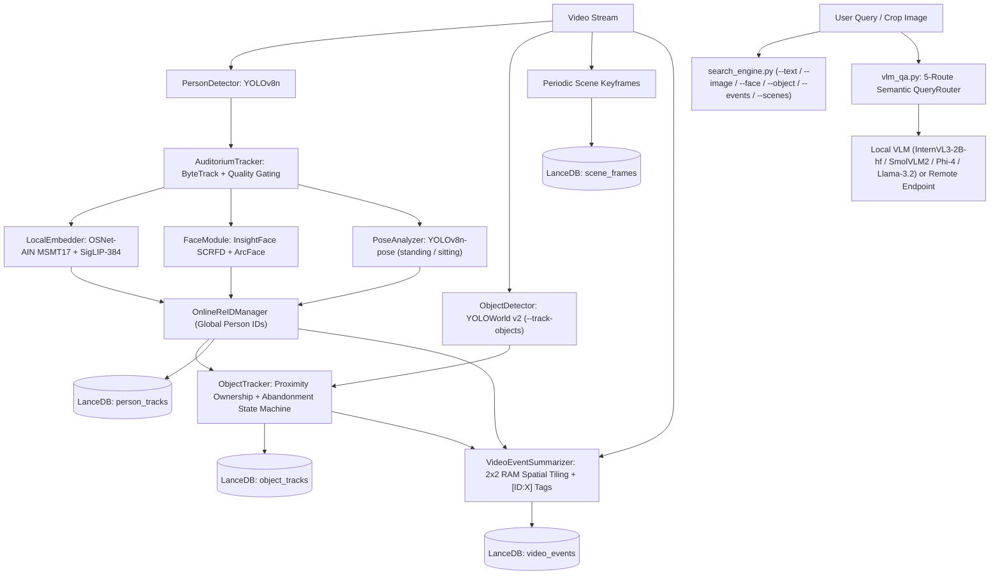

# Auditorium & Multi-Feature Track VSS

A local, privacy-preserving Video Search & Summarization (VSS) and global multi-person tracking system built with modular AI pipelines, LanceDB vector storage, and open-source Vision-Language Models (VLMs).



---

## Key Capabilities

1. **Global Multi-Person Re-Identification (`person_tracks`):**
   - Tracks people with YOLOv8n + ByteTrack across occlusions and camera re-entries using fused **MSMT17 OSNet-AIN (`osnet_ain_x1_0`)** appearance embeddings, **InsightFace SCRFD + ArcFace** top-5 crop face embeddings, and **YOLOv8n-pose** (`standing`/`sitting`) estimation.
2. **Open-Vocabulary Object Tracking, Ownership Binding & Abandonment Alerts (`object_tracks`) — Phase 1:**
   - Runs a separate **`YOLOWorld` (`yolov8s-worldv2.pt`)** detector (leaving `detector.py` unchanged) for user-prompted classes (`--track-objects "bag, backpack, handbag, suitcase, water bottle"`).
   - Binds each tracked object to its carrier/owner (`owner_track_id`, resolved to Global Person ID) and monitors stationary unattended duration against `--abandon-seconds` to flag abandoned items with an evidence scene frame.
3. **General Spatial-Windowed Video Summarization (`video_events`) — Phase 2:**
   - Divides the timeline into periodic + event-triggered windows (`--summarize`), draws `[ID:X]` and `[OBJ:Y]` tags in RAM, slices **non-empty overlapping 2x2 spatial quadrants** to capture fine-grained auditorium/classroom actions without overflowing 2B-model resolution, rolls tile notes into `[ID:X]`-tagged summaries, and indexes sentence-pooled SigLIP vectors into `video_events`.
4. **5-Route Semantic Q&A (`vlm_qa.py`) & Multi-Modal Search (`search_engine.py`):**
   - `QueryRouter` automatically classifies questions across `track_id`, `counting`, `person_forensic`, `object_ownership` (including `--image` bag queries), and `video_summary`, supporting **`OpenGVLab/InternVL3-2B-hf`**, `HuggingFaceTB/SmolVLM2-2.2B-Instruct`, `Phi-4-multimodal-instruct`, `Llama-3.2-11B-Vision-Instruct` (`--quantize 4bit|8bit`), and OpenAI-compatible remote endpoints (`--endpoint-url`).

---

## Repository File Breakdown

| File | Responsibility |
| :--- | :--- |
| [pipeline.py](file:///c:/Projects/ai-dreams/multi-feature-track-vss/pipeline.py) | Main ingestion orchestrator combining person Re-ID, periodic scene keyframes, optional `--track-objects` Phase 1 tracking, and optional `--summarize` Phase 2 event summarization. |
| [detector.py](file:///c:/Projects/ai-dreams/multi-feature-track-vss/detector.py) | Core YOLOv8n person detector (unchanged baseline). |
| [tracker.py](file:///c:/Projects/ai-dreams/multi-feature-track-vss/tracker.py) | ByteTrack person tracker with 24-frame activation gating and top-5 Laplacian sharpest-crop selection. |
| [embedder.py](file:///c:/Projects/ai-dreams/multi-feature-track-vss/embedder.py) | Unified feature extractor: MSMT17 `osnet_ain_x1_0` body Re-ID + `google/siglip-base-patch16-384` (768-d image & sentence-pooled text embeddings). |
| [face_module.py](file:///c:/Projects/ai-dreams/multi-feature-track-vss/face_module.py) | InsightFace SCRFD + ArcFace extractor with padded crop detection and tight-crop fallback. |
| [pose_module.py](file:///c:/Projects/ai-dreams/multi-feature-track-vss/pose_module.py) | YOLOv8n-pose classifier for tracklet crops (`standing`/`sitting`) and full scene frames. |
| [reid_manager.py](file:///c:/Projects/ai-dreams/multi-feature-track-vss/reid_manager.py) | Online Global Identity resolver with co-occurrence mutual-exclusion constraints. |
| [object_detector.py](file:///c:/Projects/ai-dreams/multi-feature-track-vss/object_detector.py) | Standalone open-vocabulary detector wrapping `YOLOWorld` (`yolov8s-worldv2.pt`). |
| [object_tracker.py](file:///c:/Projects/ai-dreams/multi-feature-track-vss/object_tracker.py) | ByteTrack object tracker, person-object carrier/ownership binder, and stationary-unattended abandonment state machine. |
| [video_summarizer.py](file:///c:/Projects/ai-dreams/multi-feature-track-vss/video_summarizer.py) | RAM-only 2x2 overlapping spatial quadrant VLM summarizer with `[ID:X]` / `[OBJ:Y]` legend injection and chunk rollup. |
| [vector_store.py](file:///c:/Projects/ai-dreams/multi-feature-track-vss/vector_store.py) | LanceDB manager for `person_tracks`, `scene_frames`, `object_tracks`, and `video_events`. |
| [search_engine.py](file:///c:/Projects/ai-dreams/multi-feature-track-vss/search_engine.py) | Vector similarity search CLI across people, faces, objects/clips, scene keyframes, and video event chunks. |
| [vlm_qa.py](file:///c:/Projects/ai-dreams/multi-feature-track-vss/vlm_qa.py) | 5-route semantic RAG + VLM inference CLI (`InternVL3-2B-hf`, `SmolVLM2`, `Phi-4`, `Llama-3.2`, or remote vLLM/NIM/Ollama). |
| [download_sample.py](file:///c:/Projects/ai-dreams/multi-feature-track-vss/download_sample.py) | Sample clip downloader supporting `--preset sample | abandoned_bag | classroom | bottle | all`. |

---

## Quickstart Guide

### 1. Download Sample Test Clips
```bash
python download_sample.py --preset abandoned_bag
python download_sample.py --preset classroom
```

### 2. Ingest Videos
**Baseline Person & Scene Indexing only:**
```bash
python pipeline.py --video data/raw_videos/sample.mp4
```

**Phase 1: Abandoned Bag / Open-Vocab Object Tracking & Ownership:**
```bash
python pipeline.py --video data/raw_videos/abandoned_bag.mp4 ^
  --track-objects "bag, backpack, handbag, suitcase" ^
  --abandon-seconds 3.0 ^
  --db-path data/lancedb_bag
```

**Phase 1 + Phase 2: Full Video Search, Object Tracking & Spatial-Window Summarization (`InternVL3-2B-hf`):**
```bash
python pipeline.py --video data/raw_videos/classroom.mp4 ^
  --track-objects "bag, backpack, laptop, book, bottle" ^
  --abandon-seconds 4.0 ^
  --summarize --summary-interval 8.0 ^
  --vlm-model OpenGVLab/InternVL3-2B-hf ^
  --db-path data/lancedb_classroom
```

### 3. Semantic Vector Search (`search_engine.py`)
```bash
# Find when an object crop appeared, its owner, and abandonment status
python search_engine.py --object data/object_crops/obj_2.jpg --db-path data/lancedb_bag

# Search abandoned items by text description
python search_engine.py --object-text "black suitcase or handbag" --status abandoned --db-path data/lancedb_bag

# Search Phase 2 video event chunks
python search_engine.py --events "people seated at desks having a conversation" --db-path data/lancedb_classroom

# Existing person, face & scene search
python search_engine.py --text "person in blue shirt" --pose standing
python search_engine.py --image data/crops/crop_local_1.jpg --mode reid
```

### 4. VLM Q&A (`vlm_qa.py`)
```bash
# Object ownership & abandonment Q&A with a query image crop
python vlm_qa.py --db-path data/lancedb_bag ^
  --image data/object_crops/obj_2.jpg ^
  --question "Who does this bag belong to and when was it abandoned?" ^
  --model-id OpenGVLab/InternVL3-2B-hf

# Whole-video activity & interaction Q&A
python vlm_qa.py --db-path data/lancedb_classroom ^
  --question "Summarize what happened in the video and which track IDs were interacting?" ^
  --model-id OpenGVLab/InternVL3-2B-hf

# Scene counting Q&A
python vlm_qa.py --db-path data/lancedb_classroom ^
  --question "How many people are in the classroom?" ^
  --model-id OpenGVLab/InternVL3-2B-hf
```
