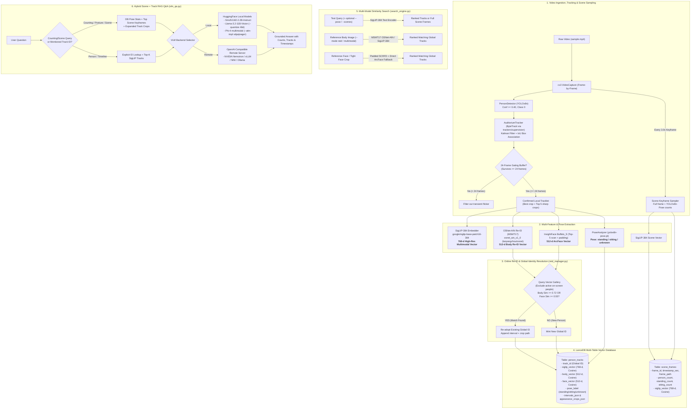

# Auditorium Tracker & Video Semantic Search (VSS) Pipeline

A modular, 100% local computer vision and video intelligence pipeline designed for single-camera auditorium surveillance, temporal tracking, **online global re-identification (Re-ID)**, pose & scene keyframe indexing, multi-feature vector search, and Vision-Language Model (VLM) post-execution Q&A.

---

## 1. End-to-End Architecture Flowchart



---

## 2. Repository File Breakdown

| File | Purpose & Responsibilities | Key Dependencies |
| :--- | :--- | :--- |
| [`detector.py`](file:///c:/Projects/ai-dreams/multi-feature-track-vss/detector.py) | **YOLOv8 Person Detection Module.** Wraps `ultralytics.YOLO("yolov8n.pt")`. Filters specifically for class `0` (`person`) with confidence $\ge 0.40$. Returns bounding boxes `[x1, y1, x2, y2]` and confidence scores. | `ultralytics`, `torch`, `numpy` |
| [`tracker.py`](file:///c:/Projects/ai-dreams/multi-feature-track-vss/tracker.py) | **Kalman Filter Tracking & Gating Buffer.** Uses `trackers.ByteTrackTracker` (with fallback to `supervision.ByteTrack`). Buffers 24 frames to eliminate flicker, ranks quality via Laplacian sharpness, and returns the sharpest crop plus the top 5 distinct sample crops for face scanning. | `trackers`, `supervision`, `opencv-python` |
| [`pose_module.py`](file:///c:/Projects/ai-dreams/multi-feature-track-vss/pose_module.py) | **Skeletal Pose Classifier.** Uses `yolov8n-pose.pt` 17-keypoint geometry (hip-knee-ankle bend angle, thigh vertical drop ratio, leg span) to classify tracks and full scene keyframes into `standing`, `sitting`, or `unknown`. | `ultralytics`, `torch`, `numpy` |
| [`reid_manager.py`](file:///c:/Projects/ai-dreams/multi-feature-track-vss/reid_manager.py) | **Online Global Re-ID Gallery Manager.** Resolves local ByteTrack tracklets to canonical Global Person IDs before database insertion using spatiotemporal mutual exclusion, MSMT17 OSNet-AIN body similarity ($\ge 0.72$), and ArcFace similarity ($\ge 0.55$). Preserves all `intervals_json` and `appearance_crops_json`. | `numpy`, `json`, `vector_store` |
| [`embedder.py`](file:///c:/Projects/ai-dreams/multi-feature-track-vss/embedder.py) | **Feature Extraction Engine.** <br/>1. **768-d SigLIP-384** (`google/siglip-base-patch16-384`): 384×384 high-res multimodal embeddings preserving small props like microphones.<br/>2. **512-d OSNet-AIN (MSMT17)**: Real metric-learned person Re-ID weights from `kaiyangzhou/osnet` (replacing ImageNet-only weights). | `transformers`, `torchreid`, `huggingface_hub`, `torch`, `PIL` |
| [`face_module.py`](file:///c:/Projects/ai-dreams/multi-feature-track-vss/face_module.py) | **Facial Feature Extractor.** Scans top-5 sharpest crops in each tracklet with border-padded SCRFD detection (upper 45% of body crop). Also provides `extract_face_from_crop()` with border padding + direct 112×112 ArcFace ONNX recognition fallback so tightly cropped `face_local_*.jpg` queries work reliably. | `insightface`, `onnxruntime`, `opencv-python` |
| [`vector_store.py`](file:///c:/Projects/ai-dreams/multi-feature-track-vss/vector_store.py) | **LanceDB Multi-Table Storage.** Manages `person_tracks` (`siglip_vector`, `body_vector`, `face_vector`, `pose_label`, `intervals_json`, `appearance_crops_json`) and `scene_frames` (full-frame keyframes + aggregate pose counts) using explicit `.metric("cosine")` search. | `lancedb`, `pyarrow` |
| [`pipeline.py`](file:///c:/Projects/ai-dreams/multi-feature-track-vss/pipeline.py) | **Master Ingestion Orchestrator.** Reads video $\to$ detects & tracks people $\to$ captures periodic full scene keyframes $\to$ extracts SigLIP-384, MSMT17 OSNet-AIN, ArcFace, and Pose $\to$ resolves Global IDs via `OnlineReIDManager` $\to$ syncs to LanceDB. | `opencv-python`, all local modules |
| [`search_engine.py`](file:///c:/Projects/ai-dreams/multi-feature-track-vss/search_engine.py) | **Multi-Modal Search CLI.** Supports `--text`, `--image` (`--mode reid` / `multimodal`), `--face` (with tight crop fallback), `--video`, `--pose standing|sitting`, `--scenes` (full scene keyframe search), and combined queries. | `opencv-python`, `numpy`, `lancedb` |
| [`vlm_qa.py`](file:///c:/Projects/ai-dreams/multi-feature-track-vss/vlm_qa.py) | **3-Route Semantic RAG Q&A Engine (`QueryRouter`).** Zero-shot routes queries without hardcoded keywords into `track_id` (exact ID timeline), `counting` (DB pose stats + scene keyframes + tracks), or `person_forensic` (focused zoomed person crops for clothing/drinks/bags/mics). Includes `AutoConfig` attention patching (`--attn-impl sdpa|eager`) for Phi-4 and `--quantize 4bit|8bit` for Llama-3.2-11B. | `transformers`, `torch`, `PIL`, `urllib` |
| [`download_sample.py`](file:///c:/Projects/ai-dreams/multi-feature-track-vss/download_sample.py) | **Data Ingestion Utility.** Downloads test surveillance video to `data/raw_videos/sample.mp4` with SSL certificate fallbacks. | `urllib`, `ssl` |

---

## 3. Quickstart Guide

### 1. Ingest Video & Build Multi-Feature + Scene Index
```powershell
# Default run (MSMT17 OSNet-AIN Re-ID, SigLIP-384, YOLOv8n-Pose, 3s scene keyframes)
python pipeline.py --video data/raw_videos/sample.mp4

# Custom thresholds and visual bounding-box preview
python pipeline.py --video path/to/video.mp4 --reid-threshold 0.72 --scene-interval 3.0 --display
```

### 2. Multi-Modal Semantic, Appearance, Pose & Face Search
```powershell
# Text search filtered by posture
python search_engine.py --text "person in blue shirt" --pose standing

# Full auditorium scene keyframe search
python search_engine.py --scenes --text "speaker holding microphone"

# Reference body appearance search (uses MSMT17 OSNet-AIN Re-ID)
python search_engine.py --image data/crops/crop_local_3.jpg --mode reid

# Face search (works with both full photos and tight self-generated face_local_*.jpg crops)
python search_engine.py --face data/crops/face_local_0.jpg
```

### 3. Vision-Language Q&A (3-Route Auto Router, Local & Remote)
```powershell
# Route: [COUNTING] -> uses DB pose stats + scene keyframes + candidate crops
python vlm_qa.py --question "How many people are standing and how many are sitting?"

# Route: [PERSON_FORENSIC] -> uses only zoomed person crops (no scene-frame distraction)
python vlm_qa.py --question "Is anyone holding a drink or wearing a handbag?"

# Route: [TRACK_ID] -> looks up exact Track ID and multi-interval timeline
python vlm_qa.py --question "When was Track 2 visible?"

# Optional manual route override
python vlm_qa.py --route person_forensic --question "Who is holding a microphone?"

# Microsoft Phi-4 Multimodal (patches AutoConfig flash_attention_2 -> sdpa or eager)
python vlm_qa.py --model-id microsoft/Phi-4-multimodal-instruct --attn-impl sdpa --question "Who is holding a microphone?"

# Meta Llama-3.2-11B-Vision in 4-bit (~7-8 GB VRAM, requires bitsandbytes + HF_TOKEN)
python vlm_qa.py --model-id meta-llama/Llama-3.2-11B-Vision-Instruct --quantize 4bit --question "Summarize people on stage."

# Remote OpenAI-compatible server (NVIDIA Nemotron / vLLM / Ollama)
python vlm_qa.py --endpoint-url http://your-server:8000/v1/chat/completions --model-name nvidia/nemotron-4-340b --question "How many people are sitting?"
```
